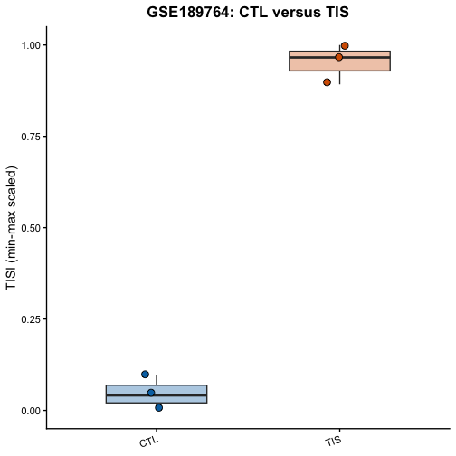

This tutorial calculates the pretrained Therapy-Induced Senescence Index (TISI)
from a gene-by-sample RNA-seq expression matrix. It uses six GSE189764 samples:
three CTL samples and three TIS persister samples.

The tutorial performs inference with the pretrained L2=10 dot-product model. It
does not retrain the model.

## 1. Requirements and installation

Run the following once in a fresh R installation. Seurat is optional and is
only needed for the scRNA-seq template.


``` r
install.packages(c("data.table", "ggplot2", "rmarkdown", "knitr"))

if (!requireNamespace("BiocManager", quietly = TRUE)) {
  install.packages("BiocManager")
}
BiocManager::install(c("AnnotationDbi", "org.Hs.eg.db"))

# Optional for a Seurat object:
# install.packages("Seurat")
```

Render from this directory:

```r
rmarkdown::render("TISI_Tutorial.Rmd")
```

## 2. Example data and provenance

The example expression file is a compact subset of the author-provided
GSE189764 normalized expression matrix. It retains all genes and only the six
required samples. The matrix is oriented as **genes x samples**:

* the first column contains HGNC gene symbols;
* the remaining columns are C1, C2, C3, gT1, gT2, and gT3;
* the values are the normalized expression values used by the original RNA-seq
  validation pipeline, described there as normalized TPM input, not raw read
  counts;
* the original scoring pipeline then applies log2(x + 1e-5), column-wise scale(),
  and row-centering before the dot product.

The sample annotation is supplied separately. The public GEO records identify
C1-C3 as controls and gT1-gT3 as TIS persister samples. Exact GEO sample
accessions are in the metadata file.


``` r
suppressPackageStartupMessages({
  library(data.table)
  library(ggplot2)
  library(AnnotationDbi)
  library(org.Hs.eg.db)
})

knitr::opts_chunk$set(fig.path = "knitr_assets/")

dir.create("results", showWarnings = FALSE)
dir.create("output_figures", showWarnings = FALSE)
dir.create("knitr_assets", showWarnings = FALSE)

expression_file <- file.path(
  "example_data",
  "GSE189764_CTL_vs_TIS_expression.csv.gz"
)
metadata_file <- file.path(
  "example_data",
  "GSE189764_CTL_vs_TIS_metadata.csv"
)
expected_file <- file.path(
  "example_data",
  "GSE189764_CTL_vs_TIS_expected_TISI.csv"
)
model_file <- file.path(
  "model",
  "Step6_SenOCLR_L2_10_final_dot.rdata"
)

stopifnot(
  file.exists(expression_file),
  file.exists(metadata_file),
  file.exists(expected_file),
  file.exists(model_file)
)
```


``` r
metadata <- fread(metadata_file)
metadata
```

```
##    sample_id condition source_group          source_note GEO_accession
##       <char>    <char>       <char>               <char>        <char>
## 1:        C1       CTL      Control              Control     GSE189764
## 2:        C2       CTL      Control              Control     GSE189764
## 3:        C3       CTL      Control              Control     GSE189764
## 4:       gT1       TIS    Persister TIS persister sample     GSE189764
## 5:       gT2       TIS    Persister TIS persister sample     GSE189764
## 6:       gT3       TIS    Persister TIS persister sample     GSE189764
##    GEO_sample_id                      source_expression_file
##           <char>                                      <char>
## 1:    GSM5706915 Benchmark_datasets/Raw_matrix/GSE189764.csv
## 2:    GSM5706916 Benchmark_datasets/Raw_matrix/GSE189764.csv
## 3:    GSM5706917 Benchmark_datasets/Raw_matrix/GSE189764.csv
## 4:    GSM5706921 Benchmark_datasets/Raw_matrix/GSE189764.csv
## 5:    GSM5706922 Benchmark_datasets/Raw_matrix/GSE189764.csv
## 6:    GSM5706923 Benchmark_datasets/Raw_matrix/GSE189764.csv
```

There are exactly three samples in each group:


``` r
stopifnot(nrow(metadata) == 6)
stopifnot(all(table(metadata$condition) == 3))
stopifnot(identical(
  metadata$sample_id,
  c("C1", "C2", "C3", "gT1", "gT2", "gT3")
))
```

## 3. Load the expression matrix and pretrained model

The pretrained model contains a named vector model$w, whose names are Ensembl
gene identifiers without version suffixes. The example matrix contains gene
symbols, so the same SYMBOL-to-ENSEMBL mapping used in the original validation
code is applied below. If an input matrix already uses Ensembl IDs, remove
version suffixes such as .12 before matching.


``` r
expression_table <- fread(expression_file)
gene_column <- names(expression_table)[1]
sample_ids <- setdiff(names(expression_table), gene_column)

expression_matrix <- as.matrix(
  expression_table[, setdiff(names(expression_table), gene_column), with = FALSE]
)
storage.mode(expression_matrix) <- "numeric"
rownames(expression_matrix) <- toupper(
  trimws(as.character(expression_table[[gene_column]]))
)

stopifnot(identical(sample_ids, metadata$sample_id))
stopifnot(all(is.finite(expression_matrix)))

model_environment <- new.env(parent = emptyenv())
load(model_file, envir = model_environment)
stopifnot(exists("SenOCLR_final", envir = model_environment, inherits = FALSE))
tisi_model <- model_environment$SenOCLR_final
stopifnot(is.numeric(tisi_model$w), !is.null(names(tisi_model$w)))

c(
  input_genes = nrow(expression_matrix),
  input_samples = ncol(expression_matrix),
  model_genes = length(tisi_model$w)
)
```

```
##   input_genes input_samples   model_genes 
##         38244             6         15729
```

## 4. Preprocessing and TISI calculation

The functions below reproduce the inference steps used in the original RNA-seq
validation code. They do not retrain the model.

Duplicate input genes are averaged before identifier matching. Genes that are
not in the pretrained model are omitted from the dot product. The score is
therefore based on the intersection of the input genes and the named model
weights.


``` r
collapse_duplicate_rows <- function(mat) {
  groups <- split(seq_len(nrow(mat)), rownames(mat))
  if (all(lengths(groups) == 1L)) {
    return(mat)
  }

  collapsed <- t(vapply(
    groups,
    function(i) colMeans(mat[i, , drop = FALSE], na.rm = TRUE),
    numeric(ncol(mat))
  ))
  colnames(collapsed) <- colnames(mat)
  rownames(collapsed) <- names(groups)
  collapsed
}

prepare_model_matrix <- function(mat, model) {
  mat <- as.matrix(mat)
  storage.mode(mat) <- "numeric"
  ids <- toupper(trimws(rownames(mat)))
  rownames(mat) <- ids
  mat <- collapse_duplicate_rows(mat)

  ensembl_fraction <- mean(grepl("^ENSG[0-9]+$", rownames(mat)))

  if (ensembl_fraction > 0.5) {
    rownames(mat) <- sub("\\.[0-9]+$", "", rownames(mat))
    mat <- collapse_duplicate_rows(mat)
    mat <- mat[!duplicated(rownames(mat)), , drop = FALSE]
    return(mat)
  }

  mapping <- AnnotationDbi::select(
    x = org.Hs.eg.db,
    keys = rownames(mat),
    keytype = "SYMBOL",
    columns = "ENSEMBL"
  )
  mapping <- mapping[!is.na(mapping$ENSEMBL), , drop = FALSE]
  mapping <- mapping[!duplicated(mapping$SYMBOL), , drop = FALSE]
  mapping <- mapping[!duplicated(mapping$ENSEMBL), , drop = FALSE]

  genes_to_keep <- intersect(mapping$SYMBOL, rownames(mat))
  if (length(genes_to_keep) == 0L) {
    stop("No input genes could be matched to the model identifiers.")
  }

  mat <- mat[genes_to_keep, , drop = FALSE]
  rownames(mat) <- mapping$ENSEMBL[match(rownames(mat), mapping$SYMBOL)]
  mat
}

normalize_exp <- function(x) {
  x_log <- log2(x + 0.00001)
  x_scaled <- scale(x_log)
  row_means <- rowMeans(x_scaled, na.rm = TRUE)
  x_scaled - matrix(
    row_means,
    nrow = nrow(x_scaled),
    ncol = ncol(x_scaled),
    byrow = FALSE
  )
}

scoreOCLR <- function(profile, model, m = "dot") {
  weights <- model$w
  genes <- intersect(names(weights), rownames(profile))
  if (length(genes) == 0L) {
    stop("No model genes are present in the expression matrix.")
  }

  weights <- weights[genes]
  profile_mat <- as.matrix(profile[genes, , drop = FALSE])

  if (m != "dot") {
    stop("This tutorial uses the pretrained dot-product TISI model.")
  }

  list(apply(profile_mat, 2, function(x) weights %*% x))
}

minmax <- function(x) {
  value_range <- range(x, na.rm = TRUE)
  if (diff(value_range) == 0) {
    return(rep(0.5, length(x)))
  }
  (x - value_range[1]) / diff(value_range)
}

calculate_tisi <- function(expression_matrix, model) {
  expression_for_model <- prepare_model_matrix(expression_matrix, model)
  normalized_matrix <- normalize_exp(expression_for_model)
  raw_score <- as.numeric(scoreOCLR(
    normalized_matrix,
    model,
    m = "dot"
  )[[1]])

  list(
    scores = data.frame(
      sample_id = colnames(expression_for_model),
      TISI_raw = raw_score,
      TISI_scaled = minmax(raw_score),
      row.names = NULL,
      check.names = FALSE
    ),
    n_input_genes = nrow(expression_for_model),
    n_model_genes_used = length(intersect(
      names(model$w),
      rownames(expression_for_model)
    ))
  )
}
```

Run the calculation and inspect model coverage:


``` r
calculation <- calculate_tisi(expression_matrix, tisi_model)
```

```
## 'select()' returned 1:many mapping between keys and columns
```

``` r
scores <- as.data.table(calculation$scores)
scores <- merge(
  metadata[, .(sample_id, condition)],
  scores,
  by = "sample_id",
  sort = FALSE
)
scores <- scores[match(metadata$sample_id, sample_id)]

print(scores)
```

```
##    sample_id condition   TISI_raw TISI_scaled
##       <char>    <char>      <num>       <num>
## 1:        C1       CTL -0.5767705  0.09661579
## 2:        C2       CTL -0.7151567  0.00000000
## 3:        C3       CTL -0.6562327  0.04113842
## 4:       gT1       TIS  0.5627462  0.89218183
## 5:       gT2       TIS  0.7171779  1.00000000
## 6:       gT3       TIS  0.6682358  0.96583049
```

``` r
cat("Input genes after preprocessing:", calculation$n_input_genes, "\n")
```

```
## Input genes after preprocessing: 22345
```

``` r
cat("Model genes used:", calculation$n_model_genes_used, "of",
    length(tisi_model$w), "\n")
```

```
## Model genes used: 15038 of 15729
```

``` r
fwrite(scores, file.path("results", "GSE189764_TISI_scores.csv"))
```

TISI_raw is the weighted dot product. TISI_scaled is the 0-to-1 min-max
transformation used for the example. A higher score indicates a more TISI-like
transcriptional state relative to the samples being scaled; it is not a
probability and is not a universal clinical cutoff.

## 5. Regression check against the expected scores

The checked-in expected-results file was generated from the same six-sample
matrix, the same pretrained model, and the same scoring functions above.


``` r
expected <- fread(expected_file)
expected <- expected[match(scores$sample_id, sample_id)]

stopifnot(identical(scores$sample_id, expected$sample_id))
max_abs_error <- max(abs(
  scores$TISI_scaled - expected$TISI_scaled
))
stopifnot(max_abs_error <= 1e-10)

cat("Maximum absolute error:", format(max_abs_error, scientific = TRUE), "\n")
```

```
## Maximum absolute error: 4.440892e-16
```

**Important reproducibility note.** The original Figure 2F analysis scored all
12 GSE189764 samples before selecting the six displayed samples. Because the
original normalization and min-max scaling depend on the columns included in a
calculation, the six-sample tutorial values are expected to differ slightly
from the six Figure 2F values. Figure 2E is a separate C12-FDG flow-cytometry/
MFI panel. The tutorial deliberately uses exactly six shipped samples so that a
new user can run the example without hidden samples; the algorithm and
pretrained weights are unchanged. To reproduce Figure 2F numerically, run the
same functions on the complete 12-sample matrix.

## 6. Visualize and export the example

With three biological replicates per group, the individual points are shown
explicitly.


``` r
scores[, condition := factor(
  condition,
  levels = c("CTL", "TIS")
)]

tisi_plot <- ggplot(scores, aes(condition, TISI_scaled, fill = condition)) +
  geom_boxplot(width = 0.55, outlier.shape = NA, alpha = 0.35) +
  geom_jitter(width = 0.08, size = 3.2, shape = 21, color = "black") +
  scale_fill_manual(values = c(
    "CTL" = "#0072B2",
    "TIS" = "#D55E00"
  )) +
  labs(
    x = NULL,
    y = "TISI (min-max scaled)",
    title = "GSE189764: CTL versus TIS"
  ) +
  theme_classic(base_size = 14) +
  theme(
    legend.position = "none",
    axis.text.x = element_text(angle = 20, hjust = 1),
    plot.title = element_text(face = "bold", hjust = 0.5)
  )

ggsave(
  file.path("output_figures", "GSE189764_CTL_vs_TIS_TISI.pdf"),
  tisi_plot,
  width = 5.2,
  height = 4.4,
  units = "in",
  device = "pdf"
)
tisi_plot
```



## 7. Apply TISI to your own bulk RNA-seq data

Replace expression_file with a gene-by-sample matrix containing either HGNC
symbols or Ensembl IDs. For Ensembl IDs, remove version suffixes such as .12.
Use the same expression scale expected by the original pipeline and do not
apply an additional log transformation before calling calculate_tisi().


``` r
user_table <- fread("path/to/my_normalized_expression.csv")
gene_column <- names(user_table)[1]
user_matrix <- as.matrix(
  user_table[, setdiff(names(user_table), gene_column), with = FALSE]
)
storage.mode(user_matrix) <- "numeric"
rownames(user_matrix) <- user_table[[gene_column]]

user_result <- calculate_tisi(user_matrix, tisi_model)
fwrite(user_result$scores, "my_TISI_scores.csv")
```

Check the number of matched model genes before interpreting results. A very low
coverage means that the score is based on only a small part of the model. Do
not compare min-max-scaled scores from unrelated datasets as if they were on a
common absolute scale; retain and report TISI_raw as well.

## 8. scRNA-seq template (per-cell scoring)

The same inference implementation can score a gene-by-cell matrix, so scores
are calculated **per cell** when cells are columns. The original scRNA-seq
workflow uses the same gene matching, log2(x + 1e-5), scaling, centering, and
dot product. It is not necessary to pseudobulk unless the scientific question
requires sample-level scores.

For a Seurat object, use the assay layer that corresponds to the input scale
expected by the original workflow. The code below uses the raw-count layer so
that the tutorial performs the documented log transformation. The conversion
to a dense matrix follows the existing implementation and can require
substantial memory for large datasets.


``` r
library(SeuratObject)

# seurat_object is an existing Seurat object.
cell_matrix <- SeuratObject::GetAssayData(
  seurat_object,
  assay = "RNA",
  layer = "counts"
)

cell_result <- calculate_tisi(cell_matrix, tisi_model)
seurat_object$TISI_raw <- cell_result$scores$TISI_raw
seurat_object$TISI_scaled <- cell_result$scores$TISI_scaled
```

For very large sparse datasets, score cells in batches or use pseudobulk
profiles after validating that the same preprocessing and gene-ID convention
are preserved. The model does not produce a probability, cell type, or clinical
threshold automatically; downstream grouping requires an explicitly reported
rule.

## 9. Troubleshooting

* **Wrong orientation:** the input must have genes in rows and samples/cells in
  columns.
* **Wrong identifiers:** use HGNC symbols or Ensembl IDs. Ensembl version
  suffixes are removed; other identifier systems require an explicit mapping.
* **Duplicate genes:** duplicate rows are averaged before matching.
* **Missing genes:** unmatched genes are omitted. Inspect model coverage and
  report it with the scores.
* **Missing values:** remove or resolve non-finite expression values before
  scoring; the dot product is not defined for NA, NaN, or Inf values.
* **Normalization mismatch:** do not treat raw counts, TPM, already log2 values,
  and Seurat normalized values as interchangeable. Match the transformation
  used by the original pipeline.
* **No matched genes:** install AnnotationDbi and org.Hs.eg.db, or provide
  Ensembl IDs that match the model.

## 10. Session information


``` r
capture.output(sessionInfo(), file = file.path("results", "sessionInfo.txt"))
sessionInfo()
```

```
## R version 4.5.1 (2025-06-13)
## Platform: aarch64-apple-darwin20
## Running under: macOS Tahoe 26.1
## 
## Matrix products: default
## BLAS:   /Library/Frameworks/R.framework/Versions/4.5-arm64/Resources/lib/libRblas.0.dylib 
## LAPACK: /Library/Frameworks/R.framework/Versions/4.5-arm64/Resources/lib/libRlapack.dylib;  LAPACK version 3.12.1
## 
## locale:
## [1] C.UTF-8/C.UTF-8/C.UTF-8/C/C.UTF-8/C.UTF-8
## 
## time zone: America/Chicago
## tzcode source: internal
## 
## attached base packages:
## [1] stats4    stats     graphics  grDevices utils     datasets  methods  
## [8] base     
## 
## other attached packages:
## [1] org.Hs.eg.db_3.22.0  AnnotationDbi_1.72.0 IRanges_2.44.0      
## [4] S4Vectors_0.48.0     Biobase_2.70.0       BiocGenerics_0.56.0 
## [7] generics_0.1.4       ggplot2_4.0.0        data.table_1.17.8   
## 
## loaded via a namespace (and not attached):
##  [1] RSQLite_2.4.3      magrittr_2.0.4     evaluate_1.0.5     grid_4.5.1        
##  [5] RColorBrewer_1.1-3 fastmap_1.2.0      blob_1.2.4         R.oo_1.27.1       
##  [9] R.utils_2.13.0     DBI_1.2.3          httr_1.4.7         scales_1.4.0      
## [13] Biostrings_2.78.0  textshaping_1.0.4  cli_3.6.5          rlang_1.1.6       
## [17] crayon_1.5.3       XVector_0.50.0     R.methodsS3_1.8.2  bit64_4.6.0-1     
## [21] yaml_2.3.10        withr_3.0.2        cachem_1.1.0       tools_4.5.1       
## [25] memoise_2.0.1      dplyr_1.1.4        vctrs_0.6.5        R6_2.6.1          
## [29] png_0.1-8          lifecycle_1.0.4    KEGGREST_1.50.0    Seqinfo_1.0.0     
## [33] bit_4.6.0          ragg_1.5.0         pkgconfig_2.0.3    pillar_1.11.1     
## [37] gtable_0.3.6       glue_1.8.0         systemfonts_1.3.1  xfun_0.54         
## [41] tibble_3.3.0       tidyselect_1.2.1   knitr_1.50         dichromat_2.0-0.1 
## [45] farver_2.1.2       labeling_0.4.3     compiler_4.5.1     S7_0.2.0
```
